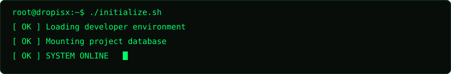

<i>HACKER 2.0 // MATRIX EDITION</i>

## `whoami`

Desenvolvimento web, projetos e aprendizado contínuo.

## `ls ./tech_stack`

## `ls ./projects`

| Repositório | Tecnologia | Acesso |
| :--- | :--- | :--- |
| [todo-list](https://github.com/Dropisx/todo-list) | TypeScript / Next.js | [Demo](https://todo-list-rho-eight-10.vercel.app) |
| [netflix](https://github.com/Dropisx/netflix) | HTML | [Código](https://github.com/Dropisx/netflix) |
| [website](https://github.com/Dropisx/website) | HTML | [Código](https://github.com/Dropisx/website) |
| [NossoCantinho](https://github.com/Dropisx/NossoCantinho) | JavaScript | [Código](https://github.com/Dropisx/NossoCantinho) |

## `./cyber-dashboard`

## `git log --activity`

## `./contribution-snake`

---

`[ CONNECTION SECURE ] // EOF`

